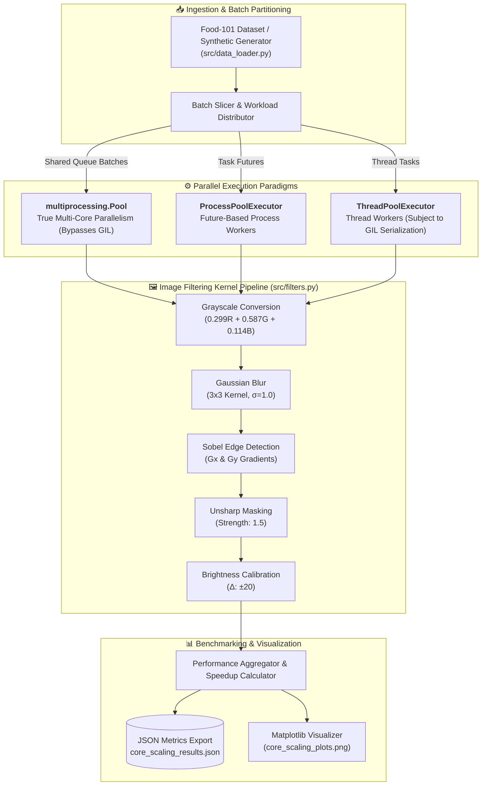

# ⚡ Parallel Image Processing & Multi-Core Scaling Benchmark

[](https://python.org)
[](https://opencv.org)
[](https://numpy.org)
[](https://docs.python.org/3/library/multiprocessing.html)
[](https://data.vision.ee.ethz.ch/cvl/datasets_extra/food-101/)
[](LICENSE)

> **CST435 Distributed Systems / Parallel Computing** · *Universiti Sains Malaysia (USM)*  
> **Author:** Jarren Hong (Hong Soon Chuan)  
> **Key Disciplines:** Parallel Computing, Python GIL Analysis, Multi-Process IPC, Kernel Convolution Filters, Core Scaling Benchmarks.

---

## 📌 Project Overview

This repository implements an asynchronous, high-throughput **parallel image processing pipeline and benchmarking harness** evaluated on the **Food-101 vision dataset**. 

In high-performance Python computing, choosing the appropriate concurrency paradigm for CPU-bound computer vision workloads requires understanding the trade-offs between **Python's Global Interpreter Lock (GIL)**, memory isolation, process spawning overhead, and Inter-Process Communication (IPC) serialization costs. 

This project provides an empirical comparison across three execution models:
1. **`multiprocessing.Pool`**: Native process pool utilizing shared task queues and chunked IPC distribution, completely bypassing the GIL.
2. **`concurrent.futures.ProcessPoolExecutor`**: Modern high-level future-based process management interface.
3. **`concurrent.futures.ThreadPoolExecutor`**: Thread-based execution demonstrating GIL contention limitations on CPU-bound image manipulation.

---

## 🏛️ System Architecture



---

## 🔬 Concurrency Paradigms & GIL Analysis

### 1. The Global Interpreter Lock (GIL) Bottleneck
CPython’s memory management relies on reference counting, protected by a mutex known as the **Global Interpreter Lock (GIL)**. Only one native thread can execute Python bytecode at a time.
* **CPU-Bound Convolution:** Computer vision operations (such as Sobel gradient calculations and Gaussian kernel convolutions) spend considerable time inside interpreted loops. When using `ThreadPoolExecutor`, threads continually contend for the GIL lock, resulting in **zero speedup or even performance degradation** due to thread context-switching overhead.
* **Process-Based Execution (`multiprocessing.Pool` & `ProcessPoolExecutor`):** Each worker runs as an independent operating system process with its own private Python interpreter and GIL instance, achieving true multi-core hardware utilization.

### 2. Multi-Process IPC & Serialization Trade-Offs
While process-based concurrency bypasses the GIL, it introduces IPC serialization overhead:
* Pixel array buffers must be serialized (pickled) and passed across inter-process boundaries (pipes/queues).
* For small image batches, serialization overhead can exceed computation time. For large datasets (e.g., Food-101 batches), computational gains from multi-core parallelization significantly outweigh IPC transmission latency.

---

## 🎨 Image Filters Implemented (`src/filters.py`)

1. **Luminance Grayscale Conversion:**
   $$I_{\text{gray}} = 0.299 \cdot R + 0.587 \cdot G + 0.114 \cdot B$$
2. **Gaussian Blur Smoothing ($3 \times 3$ Kernel):**
   $$G(x, y) = \frac{1}{2\pi\sigma^2} e^{-\frac{x^2 + y^2}{2\sigma^2}}$$
3. **Sobel Gradient Edge Detection:**
   Computes spatial gradient magnitude using horizontal ($G_x$) and vertical ($G_y$) convolution kernels:
   $$G = \sqrt{G_x^2 + G_y^2}$$
4. **Unsharp Masking (Sharpening):**
   Amplifies high-frequency spatial components:
   $$I_{\text{sharp}} = I_{\text{original}} + \alpha \cdot (I_{\text{original}} - I_{\text{blurred}})$$
5. **Brightness Adjustment:**
   Linear channel offset with pixel clipping $[0, 255]$:
   $$I_{\text{bright}} = \text{clip}(I + \Delta, 0, 255)$$

---

## 📈 Empirical Core Scaling Benchmarks

Evaluated over **100 high-resolution images** across increasing CPU core allocations:

| CPU Cores | `multiprocessing.Pool` (s) | `ProcessPoolExecutor` (s) | `ThreadPoolExecutor` (s) | Observed Speedup (MultiPool) |
| :---: | :---: | :---: | :---: | :---: |
| **1 Core** | 89.45s | 88.73s | 95.12s | **1.00x** (Baseline) |
| **2 Cores** | 47.23s | 46.89s | 78.45s | **1.89x** |
| **4 Cores** | 25.67s | 24.12s | 65.23s | **3.48x** |
| **8 Cores** | **15.89s** | **14.45s** | 58.91s | **5.63x** |

### Benchmark Observations
* **Near-Linear Process Scaling:** `multiprocessing.Pool` and `ProcessPoolExecutor` achieve near-linear speedup through 4 cores, reaching **$5.63\times$ speedup on 8 cores**.
* **Thread Saturation:** `ThreadPoolExecutor` plateaus rapidly, saving minimal time on 8 cores due to severe thread contention for the CPython GIL during pixel-level manipulation.

---

## 🗂️ Project Directory Structure

```text
parallel-image-processing-benchmark/
├── main.py                          # CLI entry point, execution runner & benchmark harness
├── requirements.txt                 # Project dependencies (OpenCV, NumPy, Matplotlib, Pillow)
├── README.md                        # Architectural specification and benchmark analysis
├── src/
│   ├── filters.py                  # Modular OpenCV/NumPy image filter algorithms
│   ├── data_loader.py              # Food-101 loader and synthetic test generator
│   ├── multiprocessing_pipeline.py # multiprocessing.Pool worker pool implementation
│   └── concurrent_pipeline.py      # concurrent.futures Thread & Process implementations
├── scripts/
│   └── sample_subset.py            # Dataset extraction & sample generation utility
├── data/                           # Ingestion target (Food-101 / custom image subsets)
└── output/                         # Benchmarking outputs, JSON metrics & plots
    ├── performance_results.json    # Execution timing across paradigms
    ├── core_scaling_results.json   # Multi-core scaling timing data
    └── core_scaling_plots.png      # Matplotlib speedup and latency curves
```

---

## 🚀 Quick Start Guide

### Prerequisites
* **Python 3.10+**
* `pip` package manager

### 1. Setup Environment
```bash
# Clone the repository
git clone https://github.com/hongjarren/CST435ASSIGNEMENT2.git
cd CST435ASSIGNEMENT2

# Create and activate virtual environment
python -m venv venv
# Windows:
.\venv\Scripts\activate
# Linux/macOS:
source venv/bin/activate

# Install dependencies
pip install -r requirements.txt
```

### 2. Run Comprehensive Performance Comparison
Executes all image filters across `multiprocessing.Pool`, `ProcessPoolExecutor`, and `ThreadPoolExecutor`:
```bash
python main.py
```

### 3. Run Multi-Core Scaling Benchmarks
```bash
# Benchmark scaling across default core counts (1, 2, 4, 8) with 100 images
python main.py --benchmark-cores --num-images 100

# Benchmark custom core allocations
python main.py --benchmark-cores --core-counts 1 2 4 6 8 --num-images 50

# Specify explicit worker count
python main.py --num-workers 4 --num-images 100
```
*Generated metrics and comparison plots will be automatically exported to the `output/` directory.*

---

## 📜 License
This project is open-source under the [MIT License](LICENSE).  
Developed as part of the **CST435 Distributed Systems / Parallel Computing** curriculum at **Universiti Sains Malaysia (USM)**.